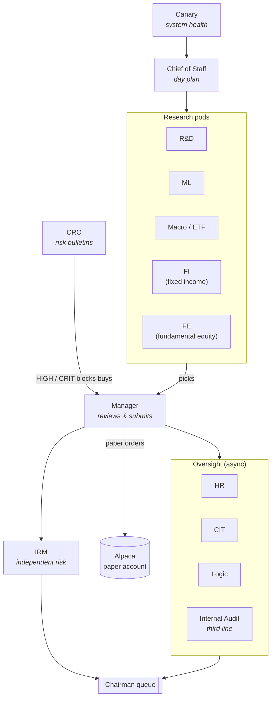

# Apex Capital

[](https://github.com/jbeard1209/apex-capital/actions/workflows/tests.yml)
[](https://github.com/jbeard1209/apex-capital/actions/workflows/codeql.yml)
[](https://www.python.org/downloads/)
[](LICENSE)
[](https://alpaca.markets/docs/trading/paper-trading/)

**A paper-trading firm I built in Python.** Sixty-plus agents — analysts,
risk officers, board members, an internal auditor — each with a narrow
job, together running a full daily research and paper-trading cycle
against the U.S. equity market.

> **Founder & Chairman:** Jack Beard.
> The firm trades against a paper Alpaca account. It does not touch real money.
> This repository is source code, not investment advice.

---

## What this is

Apex Capital is my attempt to build an autonomous trading firm from
scratch — designed as a real investment firm, with pods, a risk manager,
IRM, board, HR, and an internal audit function, because that turned out
to be the cleanest way to keep sixty-plus LLM-driven agents from stepping
on each other. I designed the org chart, chose the controls, picked
which incidents demanded which guardrails, and made every call about
what the firm actually does.

The firm runs against a paper Alpaca account. A daily pipeline
(`institutional-tracker/main.py`) fetches market and fundamental data,
lets research pods produce buy/sell picks, has a manager and risk officer
review them, submits paper orders, and writes a Chairman briefing.
Overnight and weekly, oversight agents audit the pipeline itself: broken
producer/consumer wiring, contradictions between two views of the same
number, silent data staleness, controls whose own bytecode is stale.

The point isn't "beat the market" — the honest walk-forward AUC of the
ML model is around 0.58 (see below) — but to see how far I can push a
firm-as-organization abstraction that has to keep running, day after day,
without me sitting at the keyboard.

---

## Highlights

- **~60 agents** across research, risk, HR, and oversight, wired through a
  shared queue-and-ledger substrate.
- **Two hosts, one paper account.** A Mac dev checkout and an always-on
  GCP VM (~63 cron jobs) trade the same Alpaca paper account and reconcile
  through the broker — the only medium they share.
- **A third line of defence.** `internal_audit_agent` audits the controls,
  not the firm: it runs every coherence law against a **poison pill** that
  is engineered to make the law fail. A law whose poison pill passes is
  blind, and blind is reported to the Chairman queue.
- **Coherence laws.** Each law compares two independently-sourced
  measurements of the same quantity — cash from the broker vs. cash from
  the ledger, positions from the API vs. positions from `state.json` —
  and reports incoherence rather than authoring a "truth".
- **Wiring contracts.** The recurring bug of *silent identifier
  mismatches* — a producer emitting a category name no consumer handles —
  is closed by a test-enforced contract layer
  (`test_pipeline_smoke.py::TestWiringContracts`) and a weekly sweep
  (`wiring_audit.py`).
- **Chairman decision queue.** Everything that only Jack can decide —
  arm-gates on live trading, capital reallocations, HR terminations,
  edits to protected files — funnels into a single queue with a 15-day
  board fallback and a session-start inbox that has to be dispositioned
  before new work begins.
- **A model that admits its own AUC.** `model_test_harness.py` uses
  walk-forward CV with a 20-day embargo gap, compares against a naive
  momentum baseline, reports the Brier score, and flags small-sample
  runs. `data/model_meta.json` is the only place any code is allowed
  to read a numeric AUC from.

---

## Architecture

The daily pipeline lives at `institutional-tracker/main.py`. It calls, in
order:



Every arrow is a queue or a JSON file, never an in-process call across
subsystems. That constraint is the reason each agent can run under its
own cron entry, on either host, without having to be aware of the others.

For the full brief, see [CLAUDE.md](CLAUDE.md).

### Deep dives

- [docs/ARCHITECTURE.md](docs/ARCHITECTURE.md) — daily pipeline, three
  lines of defence, coherence laws, poison-pill tests, wiring contracts,
  Chairman queue.
- [docs/QUANTITATIVE_METHODS.md](docs/QUANTITATIVE_METHODS.md) —
  walk-forward evaluation, 20-day embargo, baseline comparison, Brier
  score, feature-engineering discipline.
- [docs/POSTMORTEMS.md](docs/POSTMORTEMS.md) — the incidents whose
  guards are still load-bearing.
- [docs/INFRASTRUCTURE.md](docs/INFRASTRUCTURE.md) — where everything
  actually runs (Mac, GCP VM, Alpaca).
- [docs/kalshi_build_plan.md](docs/kalshi_build_plan.md) — the six-lane
  research plan for the Kalshi event-contract sector.
- [CONTRIBUTING.md](CONTRIBUTING.md) — pre-push gate install,
  wiring-contract rules, protected files.
- [SECURITY.md](SECURITY.md) — threat model, credential handling,
  responsible disclosure.
- [CHANGELOG.md](CHANGELOG.md) — noteworthy changes.

---

## Quantitative rigor

The single most common failure mode in this kind of project is
"remembered a good number, kept quoting it." Guarded here by:

- **One source of truth** — `model_metrics.get_model_metrics()` reads
  `data/model_meta.json`. `trained=False` means callers must show `N/A`,
  never a number.
- **Walk-forward, embargoed** — `model_test_harness.py` uses
  `TimeSeriesSplit` with a 20-day embargo between train and test so the
  label window can't leak across folds. Plain KFold on this
  time-ordered data leaks the future and inflates AUC.
- **Beat a baseline, or it doesn't count** — every model AUC is reported
  next to a naive momentum baseline; the model must beat it to add value.
- **Brier calibration + sample-size flag** — the harness reports both,
  and marks small-sample runs `SUSPICIOUS_HIGH` for leakage review.

Empirical honesty: the walk-forward AUC of the current model is ~0.58.
Feature ideas that regressed AUC (commodity momentum, bridge features)
are commented out in `feature_engineer.py` with the numeric result
attached, so the next contributor can see they were tried.

---

## Governance and controls

The interesting engineering is not in the strategies; it is in the
controls that keep 63 cron jobs from silently going wrong.

- **CIT** (Code Integrity Team) — critics of code artifacts. Finds bugs
  and drafts proposals for the board.
- **Logic Team** — finds *systemic* incoherence (distinct from CIT's code
  bugs) and can propose fixes.
- **Internal Audit** — audits the controls. Every coherence law has a
  paired **poison pill** built to make it fail; a law that reports HOLDS
  against its own pill is a blind control, and blind is a Chairman-level
  finding.
- **Chairman decision queue** with a 15-day auto-board fallback and a
  session-start inbox (`chairman_inbox.py`). Carve-outs — arm gates,
  capital allocation, HR verdicts, edits to protected files — never
  auto-escalate; they stay Chairman-only forever.
- **Sign-off ledger** — a shadow-mode autonomy gate.  Every proposal
  runs through a preflight choke point; the board and CIT vote to
  enforce; asymmetric limits govern risk-relaxing vs risk-tightening
  changes.
- **Two-host safety** — a single-writer detector counts how many hosts
  wrote orders in a window and alarms when the count is not 1. Arm
  gates (`data/.kalshi_armed`, `data/.fi_armed`) are per-host by
  construction; there is no state sync between hosts, so authorization
  travels manually or not at all.

Every one of these controls was written after a real incident. The
docstrings and inline comments (search for "postmortem", "used to say",
"until 2026-") name what broke and why the current shape exists —
so future maintainers can undo the guard for the same reason it was
put there.

---

## Getting started

See [docs/OPERATIONS.md](docs/OPERATIONS.md) for the full setup, but the
short version:

```bash
git clone https://github.com/jbeard1209/apex-capital.git
cd apex-capital
cp .env.example .env
$EDITOR .env                            # fill in your credentials

cd institutional-tracker
pip install -r requirements.txt
python3 test_pipeline_smoke.py          # smoke tests
python3 main.py                         # full daily pipeline
```

To view the dashboard:

```bash
set -a && source .env && set +a
python3 dashboard_server.py             # then open http://localhost:5050
```

---

## Repo layout

```
apex-capital/
├── README.md                    # you are here
├── CLAUDE.md                    # cold-start brief for AI sessions on this repo
├── LICENSE                      # MIT
├── .env.example                 # environment template
│
├── dashboard_server.py          # local dashboard, port 5050
├── apex_live_dashboard.html     # its front-end
│
├── docs/
│   ├── OPERATIONS.md            # run / deploy / share the dashboard
│   ├── INFRASTRUCTURE.md        # every host, account, and where things run
│   └── history/                 # dated postmortems and phase plans
│
├── scripts/
│   └── git-hooks/pre-push       # runs the smoke suite twice (local + UTC)
│
└── institutional-tracker/       # THE FIRM
    ├── main.py                  # daily pipeline entry point
    ├── config.py                # tickers, thresholds, org
    ├── requirements.txt
    │
    ├── canary_agent.py          # system health (GREEN/ORANGE/RED)
    ├── chief_of_staff_agent.py
    ├── manager_agent.py         # reviews picks, submits orders
    ├── risk_manager_agent.py    # CRO
    ├── irm_review_agent.py      # independent risk
    ├── hr_agent.py
    │
    ├── research_team.py         # pod orchestration
    ├── pod1_rd_*.py             # R&D pod
    ├── pod2_ml_*.py             # ML pod
    ├── pod3_macro_*.py          # macro/ETF pod
    ├── fi_*.py                  # fixed-income pod
    ├── fe_*.py                  # fundamental-equity pod
    │
    ├── cit_*.py                 # code integrity — bug hunters
    ├── logic_team*.py           # logical/systemic incoherence
    ├── internal_audit_agent.py  # third line of defence
    ├── coherence_laws.py        # two-source measurement equalities
    │
    ├── chairman_inbox.py        # session-start decision inbox
    ├── chairman_decision_sla.py # 15-day auto-board fallback
    ├── chairman_decision_categorizer.py  # single-source taxonomy
    │
    ├── wiring_audit.py          # weekly dead-integration sweep
    ├── test_pipeline_smoke.py   # smoke + wiring contracts (~6000+ tests)
    ├── model_test_harness.py    # walk-forward AUC vs baseline
    │
    ├── predictive_model/        # ML feature engineering + training
    ├── gcp_setup/               # deploy.sh for the always-on VM
    │
    └── data/                    # runtime state (selectively gitignored)
```

---

## Honest caveats

- **Paper only.** The firm has no path to submit real orders. The
  `alpaca_trader` config points at `paper-api.alpaca.markets`. Every
  live-trading transition needs an arm-gate file that is gitignored
  by design.
- **Kalshi is off-limits.** Kalshi contracts are CFTC-regulated; no
  Apex code ever places a bet or handles my Kalshi credentials. A
  research mirror exists purely to study calibration.
- **AI-assisted, not autonomous.** I designed the firm, chose the
  controls, and made every architectural and governance call. I used
  Claude (Anthropic) as my primary coding tool — the way most modern
  devs use a language model — to iterate on implementation, tests, and
  postmortems. The design, the incidents that shaped it, and the
  judgment about what the firm should and shouldn't do are mine.
- **This is a learning project.** It is not investment advice, not a
  fund, and not a recommendation to buy or sell anything. Its purpose
  is to see how far the institutional-firm analogy can carry a fleet
  of narrow AI agents run by one person.
- **The ML AUC is ~0.58, not 0.67.** The earlier holdout number was
  the leaky one. Both are recorded — the honest one is the walk-forward
  with embargo.

---

## Credits

- **Founder, Chairman, Architect:** Jack Beard — designed the firm,
  wrote the governance model, made every call about what does and
  doesn't ship.
- **Coding assistant:** Claude (Anthropic) — used as an IDE-level
  tool for typing out implementations, tests, and postmortem writeups
  under my direction.
- **Data:** Alpaca (paper), EDGAR (SEC filings), FRED (macro),
  yfinance, and various open sources.

---

## License

MIT — see [LICENSE](LICENSE).
