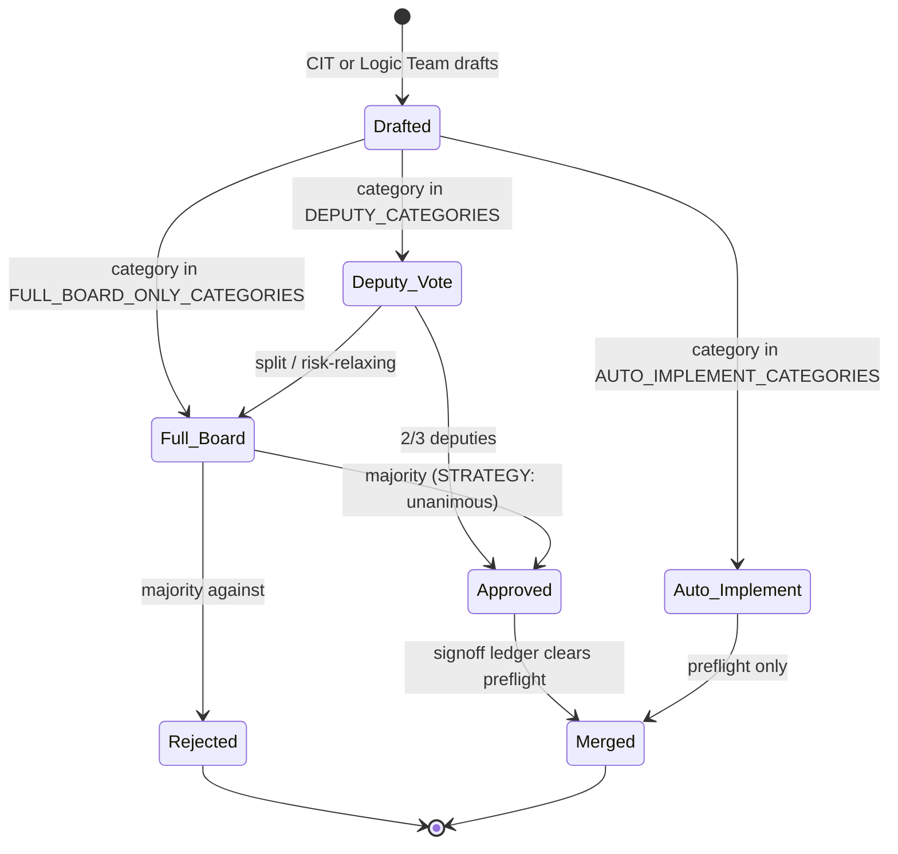

# Architecture

Apex Capital runs as a fleet of ~60 narrow agents wired together by
queues and ledgers rather than by function calls. That design is
not aesthetic; it is the constraint that keeps sixty processes on
two hosts, each with its own cron entry, running for months
without a supervisor.

This document walks the pipeline top-down and then explains the
three lines of defence layered around it.

## The daily pipeline

`institutional-tracker/main.py` is the entry point. In order, it
invokes:

1. **Canary** (`canary_agent.py`) — computes a system-health verdict
   of `GREEN` / `ORANGE` / `RED`. `RED` blocks the rest of the
   pipeline from writing to the trading path.
2. **Chief of Staff** (`chief_of_staff_agent.py`) — builds the day
   plan and instantiates the pods.
3. **Research pods** — five specialist teams:
   - **R&D** pod (`pod1_rd_*.py`) — momentum, event, technical.
   - **ML** pod (`pod2_ml_*.py`) — the walk-forward evaluated
     predictive model plus a live tests-runner.
   - **Macro** pod (`pod3_macro_*.py`) — ETF and sector rotation.
   - **FI** pod (`fi_*.py`) — fixed income.
   - **FE** pod (`fe_*.py`) — fundamental equity (deep value,
     EPV-anchored).
4. **Manager** (`manager_agent.py`) — reviews picks, applies
   position sizing, and submits paper orders through
   `alpaca_trader.py`.
5. **CRO** (`risk_manager_agent.py`) — computes risk bulletins.
   A `HIGH` or `CRITICAL` bulletin blocks all buys firm-wide.
6. **IRM** (`irm_review_agent.py`) — the independent risk manager.
   Reviews the manager's decisions after the fact and can escalate
   to the Chairman queue.
7. **Chairman briefing** — a summary of the day, delivered via
   the app inbox rather than email (see the email-leak
   postmortem).

Every arrow between agents is a **JSON queue file** or a **ledger
file**, never an in-process call. That is the design invariant.
The reason: any agent can run under any cron entry on either host
without having to know about the others. A queue writer does not
have to import the reader; a reader does not have to be running
when its item is written.

Concrete queues you can grep for:

- `data/cit_pending_proposals.json` — CIT-drafted proposals awaiting
  the board.
- `data/chairman_decision_queue.json` — items awaiting the
  Chairman.
- `data/signoff_ledger.json` — the pre-flight autonomy ledger.
- `data/firm_channel.json` — the firm-wide broadcast log.

## Two hosts, one paper account

The firm runs on a **Mac dev host** and on a **GCP VM**
(`apex-capital-495523`). Both call the same paper Alpaca account.
There is **no state sync** between hosts — Railway was
decommissioned 2026-07-10 and nothing replaced it. The broker is
the only medium both hosts share.

Two consequences shape the code:

- **`single_writer_detector`** — counts, from the broker's own
  order log, how many hosts wrote paper orders in the window and
  alarms if the count is not 1. Only the broker can count hosts;
  a heartbeat file on the host itself begs the question.
- **Per-host arm gates** — `data/.kalshi_armed`, `data/.fi_armed`
  are gitignored by design. Arming live trading on one host does
  not arm the other. This is intentional: arming is a
  physically-present action, not a state that syncs.

## The three lines of defence

Financial firms describe internal risk as three concentric rings:
the business, the risk officers, the internal auditors. Apex is
built the same way.

### First line — the business

The pods produce picks; the manager submits orders. This is where
revenue would come from, if the firm traded real capital. It does
not.

### Second line — the risk officers

- **CRO** (`risk_manager_agent.py`, called from `main.py`) —
  computes bulletins from the pipeline output. HIGH / CRITICAL
  blocks buys firm-wide.
- **IRM** (`irm_review_agent.py`) — independent second read.
  Reviews the manager's decisions and can escalate.

Second line watches the first. That is straightforward.

### Third line — internal audit

Second line reads what the first line produced. That is a
`critique(artifact)` shape, and it has a specific blindness: it
cannot see what was never in its input. A silent drop, a control
that never fires, a relation between two correct artifacts that
disagrees — those are invisible to `critique`.

`internal_audit_agent.py` is the third line. It audits the
**controls**, not the firm. Three moves:

1. **The poison-pill test.** Every coherence law is paired with an
   input engineered to make it fail. The audit runs each law
   against its pill. A law whose pill passes is a **blind
   control** — every `HOLDS` it ever reported was worthless.
2. **Denominators.** A `HOLDS` verdict must carry `n_examined`.
   A law that says "no violations found" on zero rows is not a
   pass, it is a silence. The audit enforces the denominator.
3. **Detector refs are AST-resolved.** The registry that maps
   failure classes to their detectors is resolved from the AST,
   not grepped. `grep` matches string literals; the AST matches
   what actually runs.

Blind findings escalate directly to the Chairman queue. Everything
else routes to CIT as a proposal.

## Coherence laws

`coherence_laws.py::CoherenceLaw` is the pattern for the second
line's most useful class of check. A coherence law compares **two
independently-sourced measurements of the same quantity** and
alarms when they disagree. It does not choose which side is right;
it reports incoherence.

Concrete examples:

- **Cash-from-broker vs cash-from-ledger** — the API says $X, the
  ledger says $Y. If X ≠ Y, someone is lying.
- **Positions-from-API vs positions-from-state.json** — same
  shape, different quantity.
- **Buys-blocked-by-CRO vs orders-submitted** — if the CRO
  reports BLOCK and orders still hit the broker, the guard is on
  one path but not the others (see the "guardrail on one path"
  postmortem).

Each law carries a paired poison pill. A new law without a pill
fails the internal-audit suite. That is enforced, not
aspirational.

## Wiring contracts

The system's most recurring bug class is a **silent identifier
mismatch**: a producer emits a rule name, pod name, or category
that no consumer handles. `.get()` and `try/except` swallow it,
and the pipeline runs without ever noticing that a piece of it
was never wired.

Three such bugs shipped in the same month (June 2026). The fix
was `test_pipeline_smoke.py::TestWiringContracts`: a test class
that iterates every producer's emitted set and asserts each item
is in the consumer's handler table. `wiring_audit.py` does the
same sweep offline every week.

When a PR adds a routed item, it also adds a `TestWiringContracts`
case. That is a `CONTRIBUTING.md` rule and a review criterion.

## The chairman queue

The four **carve-outs** — arm gates, capital allocation, HR
verdicts, edits to protected files — never auto-escalate. They
sit in the Chairman queue until Jack dispositions them.

Everything else has a 15-day SLA. If Jack does not decide within
15 days, `chairman_decision_sla.py` writes a `STRATEGY`
proposal into `data/cit_pending_proposals.json` and the board
decides on his behalf. `STRATEGY` proposals require a **unanimous
4/4 board vote** — a majority is not enough, and a single
abstention blocks. The firm does not stall, and the bar for the
board to act unilaterally is deliberately high.

## State-machine of a proposal

The **sign-off ledger** is the last preflight. Every proposal
runs through it before landing. It is asymmetric: risk-tightening
changes clear easily; risk-relaxing changes need CIT + board
enforce to flip. That asymmetry exists because "loosen a limit"
was the historical failure mode.

## What the code does NOT do

- No live orders. The `alpaca_trader` config points at
  `paper-api.alpaca.markets`, and no code path can flip that at
  runtime.
- No shared state between hosts. Any migration runs on each host
  independently.
- No credential in a commit. Git history was scrubbed 2026-09-29
  via `git-filter-repo`.
- No "one true auditor." Every control has a pill; every pill has
  a denominator; every denominator is checked.
